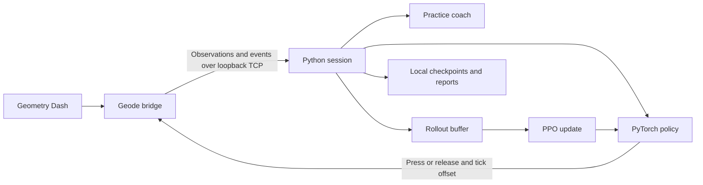

# Architecture

## Data flow

## Observation and action interface

Protocol version 4 uses a TCP connection from the mod to a Python server bound
to loopback. The handshake contains the level identity, observation dimensions
and level length. State messages contain position, progress, player-state values
and the encoded grids. Events describe starts, deaths, completions and switches.

Current observation layout: 30 channels x 11 rows x 16 columns, plus 68 numeric
values. Channels are ten object kinds for each of three views. There are eight
actions: press or release, each at one of the four ticks in a decision window.

## Training

The current policy combines convolutional grid features and numeric features.
Optional GRU memory is reset at attempt starts. The learner collects 4,096
decisions per rollout and uses PPO. The practice coach chooses checkpoints
before recurring death locations and returns to full runs after section practice.
Exact details and defaults live in `brain/brain2.py`, not in this overview.

Optional replay experiments perturb previous attempts and can generate imitation
examples; they are off by default. Reviews of previously completed levels are
also opt-in. Model widening supports older observations and policy heads.

## Validation boundaries

The standalone simulator tests tick scheduling, protocol integration and learning
bookkeeping without game assets. It is a simplified deterministic environment;
success there does not establish performance or completion rates in real GD.
The C++ bridge requires a matching game and Geode version. A successful build
alone is not an in-game compatibility or performance test.
